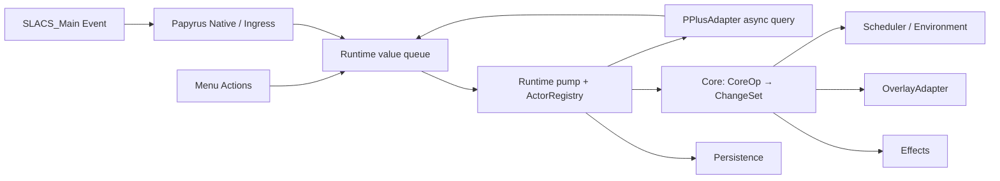

# SLACS2 NG 模块接口契约

本文定下逐步实现所需的模块接口，供后面的实现直接使用。目标为 Skyrim SE 1.6.1170、CommonLibSSE-NG、C++23，命名空间为 `slacs`。每步同时完成模块和调用方；类的私有实现可调整，表中的参数、结果和所有权保持一致。

## 1. 固定边界与身份

| 项目 | 契约 |
| --- | --- |
| 运行时 | 只接受 Skyrim SE `1.6.1170.0`；Plugin Load 检查 runtime 并登记 Papyrus/消息回调；DataLoaded 再查依赖和表单，session ready 后开放事件入口。 |
| 事件 Quest | 在 `SLACS_2_Plus_SCO.esp` 中复用 `SLACS_Main_Q`，原记录 `04000D62`，本插件 local FormID `0x000D62`。 |
| Quest 脚本 | 保留 `SLACS_Main extends Quest`，由 `SLACS_Main.psc` 编译为 `SLACS_Main.pex`；不另建 Quest 或桥脚本。 |
| Papyrus native | 同一类声明 `NotifyOrgasm(Form, int)`, `NotifySceneStart(int, bool)`, `NotifySceneEnd(int, bool)`，均为 `Global Native`。事件转发名为 `OnPPlusOrgasm`、`OnPPlusStart`、`OnPPlusEnd`。 |
| 订阅 | `RegisterEvents` / `UnregisterEvents` 管理 `SexlabOrgasmSeparate`、`HookAnimationStart`、`HookAnimationEnd`；事件只转发参数。 |
| P+ 语义 | 只有 `SexlabOrgasmSeparate(Form sourceActor, int tid)` 自动产生加层。两个 Hook 只开始/结束 tid 上下文、查询和取消。tid 保持 P+ 当前过程身份，不创建替代 scene ID。 |
| 状态 | 一份 Core 权威状态。ActorRegistry、RaceMenu 和法术模块可有非权威运行时缓存，但不能另存可独立修改的层状态。 |
| 执行阶段 | 未确认线程的回调只复制值并入队。解析 Form、查 P+、采环境、访问法术和 RaceMenu 均在经 1170 验证的游戏执行阶段；队列 pump 有界且串行。 |

Papyrus 注册入口固定为 `bool slacs::Native::Register(RE::BSScript::IVirtualMachine*)`，由 SKSE 的 Papyrus 注册回调调用，绑定类名 `SLACS_Main`。C++ 全局 native 的参数布局由该注册实现匹配上表；Papyrus Event 不等待 C++ 结果。

## 2. 模块图与首次实现步骤



| 步骤 | 首次实现的接口 | 当步交接 |
| --- | --- | --- |
| S1 | `core/Types.h`、`runtime/Runtime.h`、`runtime/Ingress.h`、`runtime/ActorRegistry.h`、`config/Settings.h` | 依赖检查、共享 DTO、线程安全值队列、FormID/ActorId/handle 映射、旧行为默认设置。 |
| S2 | `integration/Papyrus.h` | 原 `SLACS_Main` Quest 收到三种 Event 后调用 Global Native；native 只复制 FormID/tid/标志并投递 Runtime。 |
| S3 | `integration/PPlusAdapter.h` | Runtime 将有效 orgasm 请求交给 P+ 查询；一次完整结果或失败回 Runtime 队列，再转换成 `CoreOp::AddLayers`。 |
| S4 | `core/Core.h`、`integration/OverlayAdapter.h` | Core 处理 `BodyVaginal` 一处；`ChangeSet` 交 OverlayAdapter 更新 RaceMenu 自有覆盖层。 |
| S5 | `persistence/Serialization.h` | SKSE co-save 同步读写 FormID 与纯逻辑状态；load staging 由 Runtime 绑定到新会话 ActorId 后替换 Core 状态。 |
| S6 | `runtime/Scheduler.h`、`integration/Environment.h` | 共享 deadline 与采样值交给 `CoreOp::Advance`，实现自然衰减、已观测雨时段和游泳即清。 |
| S7 | `integration/Effects.h` 及区域/资源配置扩展 | 增加其余区域、资源 profile、期望法术状态；仍由同一 Core 状态推导。 |
| S8 | `ui/Menu.h`、配置文件读写 | 中文菜单读取快照、发送值操作；显式保存配置至指定 JSON 路径。 |
| S9 | 不新增模块接口 | 集成共存、打包及运行时验收；只修复本契约已经承诺的边界。 |

目录与头文件名使用本表中的路径；若实现中拆分私有文件，不改变这些公开契约。

## 3. 公共值类型

基础身份、时钟、P+ DTO 及 `ClockDomain/DeadlineKind` 枚举定义在 `src/core/Types.h`；`CoreOp/ChangeSet` 在 `core/Core.h`，`RuntimeCommand/MenuAction` 在 `runtime/Ingress.h`。依赖方向为 `Types → Settings → Core/Ingress → Runtime/adapters/Menu`，下层头文件不反向包含上层。这些值不借用引擎对象、指针、`string_view` 或调用栈内存。

| 类型 | 字段 / 单位 | 约束 |
| --- | --- | --- |
| `ActorId` | `std::uint64_t` | 当前游戏会话内由 ActorRegistry 分配；0 无效；不可保存到档案。 |
| `FormId` | `std::uint32_t` | 可重映射的 Skyrim 引用身份；仅作为值用于 native ingress、ActorRegistry 和存档。 |
| `SessionEpoch`, `RequestId`, `IngressSequence`, `Revision`, `DeadlineId` | `std::uint64_t` | 仅作插件内部取消、重试幂等和修订检查；不替代 P+ tid。 |
| `Tid` | `std::int32_t` | P+ 当前动画过程 ID；不因查询或同一 tid 上多次高潮而去重。 |
| `GameHours` | `double` | 游戏日历小时；自然衰减和雨中暴露预算使用。 |
| `ActiveSeconds` | `double` | 本插件定义的活动游戏秒；120 秒清除默认按它计时，暂停/菜单时不递减。不是 `steady_clock` 秒。 |
| `GameTime` | `{ GameHours calendarHours; ActiveSeconds activeSeconds; }` | 值快照；日历倒退/异常差由 Runtime 在送入 Core 前处理。 |
| `SteadyTime` | `std::chrono::steady_clock::time_point` | 用于异步 timeout、pump budget、失败重试冷却和任务唤醒，不计入图层业务时间。 |
| `Region` | `BodyVaginal, BodyAnal, BodyBreast, BodyLegs, Face, Hands, Feet` | 逻辑区域；RaceMenu Body/Face/Hands/Feet 位置不进入 Core。S4 仅启用 `BodyVaginal`。 |
| `TextureVariant` | `Normal, Mega` | 资源选择值，不是材质槽。普通/UBE profile 由 target 资源配置决定。 |
| `LayerRecord` | `{ std::uint64_t id; std::uint16_t textureIndex; TextureVariant variant; }` | 向量顺序即创建顺序；新层追加。旧 LIFO 衰减删除末项。 |
| `RegionState` | `{ std::vector<LayerRecord> layers; double decayRemainderGameHours; Revision revision; }` | 业务层数与可见槽数分开；余量保存自然时间与已观测雨水时间合并后不足一层的预算，单位为游戏小时。 |
| `ActorState` | `{ ActorId actor; FormId formId; std::array<RegionState, 7> regions; double lastSettledGameHours; std::optional<ActiveSeconds> timedClearAt; Revision revision; }` | Core 唯一权威记录。`timedClearAt` 是会话内 active-seconds 截止值；存档转成剩余秒数。 |
| `InteractionTarget` | `{ ActorId actor; std::vector<Region> regions; TextureVariant variant; }` | PPlusAdapter 已按成功事件、source/target 方向及本地 P+ 查询结果整理；Core 不查 P+。 |
| `ResolvedOrgasm` | `{ ActorId source; Tid tid; IngressSequence sequence; SessionEpoch epoch; std::vector<InteractionTarget> targets; }` | P+ 查询成功后的纯值；每个合法 Separate 事件有各自 sequence，可同 source/tid 多次。 |
| `PPlusFailure` | `{ RequestId requestId; SessionEpoch epoch; Tid tid; IngressSequence sequence; PPlusFailureCode code; }` | 一个已接受查询的唯一失败终态；不得含 VM 对象或 Form 指针。 |
| `EnvironmentSample` | `{ ActorId actor; bool interior; bool raining; bool snowing; bool swimming; GameHours observedRainHours; GameTime at; }` | 布尔值描述当前时点；`observedRainHours` 是自上次采样后实际观测的暴露增量，每份采样只消费一次。采样中断、睡眠、旅行和未加载间隔贡献 0。 |

运行预算和队列结果同样是共享值：

```cpp
enum class RuntimeModule : std::uint8_t { Runtime, Ingress, PPlus, Core, Scheduler,
    Environment, Overlay, Effects, Settings, Menu, Persistence, Papyrus };
enum class RuntimeDiagnosticCode : std::uint16_t { DependencyUnavailable, VersionMismatch,
    InvalidNativeForm, ActorUnavailable, QueryFailed, QueryTimedOut, QueryCancelled,
    StaleEpoch, StaleRevision, CapacityUnavailable, AdapterFailure, SettingsRejected,
    PersistenceFailure, QueueOverloaded };
struct RuntimeDiagnostic { RuntimeModule module; RuntimeDiagnosticCode code;
    SessionEpoch epoch; std::optional<Tid> tid; std::optional<IngressSequence> sequence;
    std::optional<RequestId> requestId; std::optional<ActorId> actor;
    std::optional<FormId> form; std::optional<std::uint64_t> operationId; };
enum class DependencyKind : std::uint8_t { Runtime1170, PPlus, RaceMenuV2,
    MenuFramework, RequiredForms };
enum class DependencyStatus : std::uint8_t { Available, Missing, VersionMismatch };
struct DependencyCheck { DependencyKind dependency; DependencyStatus status;
    std::string expectedVersion; std::string actualVersion; };
struct DependencyReport { bool ready; std::vector<DependencyCheck> checks; };

struct WorkBudget { std::uint32_t maxCommands; std::uint32_t maxDeadlines;
                    std::chrono::microseconds maxWallTime; };
struct PumpReport { std::uint32_t commandsProcessed; std::uint32_t deadlinesProcessed;
                    std::uint32_t rejectedStale; std::uint32_t deferred;
                    bool queueHasMore; std::vector<RuntimeDiagnostic> diagnostics; };
enum class IngressStatus : std::uint8_t { Accepted, SessionClosed, Overloaded };
struct IngressResult { IngressStatus status; std::optional<IngressSequence> sequence; };
```

`maxWallTime` 只限制一次 pump 的执行时长，不作为业务时钟。Ingress 在容量满、关闭或分配失败时返回相应状态；不静默丢弃菜单/Native 业务命令。`Accepted` 代表命令已进入队列，之后处理失败通过诊断报告。

序列化只写 `FormId`，不写 `ActorId`、native handle、绝对 active-seconds 截止值或引擎对象。内部运行身份在读档后重新绑定。

## 4. Runtime ingress 与 ActorRegistry（S1）

跨线程 ingress 与纯业务输入是两个不同 variant。Runtime 命令描述“发生了什么”；CoreOp 描述“业务状态怎样变化”。Runtime 负责校验 epoch/tid、解析身份、异步编排和把有效输入转换为 CoreOp。

```cpp
using RuntimeCommand = std::variant<NativeOrgasm, SceneNotice, PPlusCompleted,
    EnvironmentObserved, DeadlineElapsed, MenuAction, ActorVisualInvalidated,
    LoadNotice>;

using CoreOp = std::variant<AddLayers, ClearRegions, Advance, SettingsChanged>;
```

| DTO | 字段 | 含义 |
| --- | --- | --- |
| `NativeOrgasm` | `{ FormId sourceFormId; Tid tid; IngressSequence sequence; SessionEpoch epoch; }` | Papyrus callback 转发的一次成功 P+ orgasm 通知。sequence 在 ingress 锁内分配并随入队原子排序；native 不查询/写 ActorRegistry。 |
| `SceneNotice` | `{ enum Phase { Start, End } phase; Tid tid; bool hasPlayer; SessionEpoch epoch; }` | typed Hook 原参数；只更新 Runtime 的 tid 上下文或取消查询。 |
| `PPlusCompleted` | `{ RequestId requestId; SessionEpoch epoch; std::variant<ResolvedOrgasm, PPlusFailure> outcome; }` | P+ 查询唯一终态值；Runtime 验证 request、epoch 和 tid 仍有效后处理。 |
| `EnvironmentObserved` | `{ EnvironmentSample sample; }` | 在游戏执行阶段采样后入队/直接泵入；不含 Actor 指针。 |
| `DeadlineElapsed` | `{ DeadlineId id; ActorId actor; DeadlineKind kind; SessionEpoch epoch; std::optional<Region> region; Revision ownerRevision; }` | 期限唤醒只是提示；Runtime/Core 再核对相应 actor/region revision，过期 owner revision 无副作用。 |
| `MenuAction` | `std::variant<ApplySettings, ClearActor, RefreshActor, TestAdd, TestClear, RefreshActorCandidates, SelectCrosshairActor>` | 每个动作均携带创建时 `SessionEpoch`；actor 动作含 `ActorId`，Runtime 拒绝过期会话动作。候选刷新与准星查询由 Runtime 在游戏线程执行，结果按值缓存到连续数组并发布菜单快照；常规 pump 不枚举场景角色。详细字段见 S8。 |
| `ActorVisualInvalidated` | `{ ActorId actor; Revision revision; SessionEpoch epoch; }` | RaceMenu 安装或 3D 重建后请求重新 reconcile；epoch 随被观察的会话保存，不保存节点或材质。 |
| `LoadNotice` | `{ enum Phase { Begin, Complete, Failed, NewGame, Revert } phase; SessionEpoch epoch; }` | 由 Runtime 生命周期处理，不传给 Core::apply。 |

`AddLayers` 字段为 `{ ActorId source; Tid tid; IngressSequence sequence; std::uint64_t selectionSeed; std::vector<InteractionTarget> targets; }`。Runtime 提供随机种子，Core 据此选择稳定纹理编号；Core 不访问系统随机源。`ClearRegions` 为 `{ ActorId actor; std::vector<Region> regions; }`。`Advance` 为 `{ ActorId actor; GameTime now; std::optional<EnvironmentSample> environment; }`，无环境采样时只推进日历与活动时间。`SettingsChanged` 是空标记；活动 `Settings` 由 `Core::apply` 参数提供。CoreOp 不携带外部 callback 或生命周期命令。

核心签名：

```cpp
SessionEpoch Runtime::epoch() const noexcept;
IngressResult Runtime::enqueue(RuntimeCommand command);
PumpReport Runtime::pump(const GameTime& now, WorkBudget budget);
IngressResult Ingress::post(RuntimeCommand command);
IngressResult Ingress::postOrgasm(FormId sourceFormId, Tid tid, SessionEpoch epoch);
std::optional<ActorId> ActorRegistry::bind(FormId formId); // 仅游戏执行阶段
std::optional<ActorLease> ActorRegistry::resolve(ActorId actor, ResolveNeed need); // 临时借用
std::optional<FormId> ActorRegistry::formId(ActorId actor) const;
void ActorRegistry::reset(SessionEpoch epoch);
```

ActorRegistry 内部持有 `ActorId -> RE::ActorHandle` 与 `FormId -> ActorId` 映射。`ResolveNeed` 为 `{ ActorOnly, ActorWith3D }`。`ActorLease` 字段为 `{ RE::ActorHandle handle; RE::NiPointer<RE::Actor> actor; RE::NiPointer<RE::NiAVObject> root; }`；`root` 仅在要求 3D 且当次解析成功时非空。Lease 仅在当前同步 adapter 调用范围有效；`resolve` 每次重新解析并检查删除状态及所需 3D。不得把 handle/lease、`NiPointer`、3D 或 Form 裸指针写入命令、Core 状态、Scheduler deadline 或异步请求。FormID 无效、Form 不是 Actor 或对象已删除时返回空值并产生可定位诊断。

Runtime 保有队列、epoch、tid 活动表和唯一 pump。`postOrgasm` 在同一短锁中分配严格递增 sequence 并追加命令，因此同一 tid 的 Native 事件建立可排序的入口顺序；锁释放后才执行 RE、VM、RaceMenu 或 Core 逻辑。`pump` 按条目数/时间预算处理，不在同一 SKSE task 中无条件自排队。

```cpp
enum class SessionReason : std::uint8_t { NewGame, PreLoadGame, Revert };
enum class LoadCommitStatus : std::uint8_t { Committed, NotReady, NoStaging, Invalid };
struct LoadCommitResult { LoadCommitStatus status; std::uint32_t restored;
                          std::uint32_t skipped; };
DependencyReport Runtime::checkDependencies() const;
bool Runtime::initialize();
void Runtime::beginSession(SessionReason reason);
void Runtime::onLoadStaging(LoadResult result);
LoadCommitResult Runtime::commitLoadStaging();
void Runtime::onSessionReady();
void Runtime::shutdown();
void Runtime::publishSaveSnapshot();
```

实现说明：`commitLoadStaging` 在 SKSE 未调用本插件 load callback（没有 co-save 记录）时按空档 `Committed` 提交；读档数据非法或 epoch 不匹配时返回 `Invalid`，Runtime 随后以空状态开放入口，避免永久关闭。当前实现不再返回 `NotReady`/`NoStaging`，枚举值保留用于兼容契约。

`initialize` 在 DataLoaded 检查 P+、RaceMenu ABI、菜单框架和必要表单；失败时返回 false 并保持 ingress 关闭。Papyrus 函数绑定在此之前完成。`beginSession` 先原子关闭入口并递增 epoch，再通过 S1 验证的生命周期屏障与 pump 串行地取消旧请求、清空缓存及准备 staging。`onLoadStaging` 只交换纯值缓冲；`commitLoadStaging` 在游戏执行阶段绑定身份、恢复状态并返回计数。`onSessionReady` 在新会话就绪后开放入口、重订阅 Quest；`shutdown` 关闭入口并等待自身执行资源退出。所有 actor 菜单动作校验当前 epoch。

每个完整 pump 都调用 `publishSaveSnapshot`，即使只有时钟推进也发布新的剩余秒数。save callback 原子读取已发布快照，不等待 pump。Runtime 每轮依次处理生命周期、P+ 完成值、输入命令和到期项，执行 ChangeSet，再发布保存与菜单快照；每类处理均服从 WorkBudget。

## 5. Papyrus 接入（S2）

既有 `SLACS_Main` 同时实现事件 Event 与三个 Global Native 声明。实际事件参数保持原样：

```cpp
bool Native::Register(RE::BSScript::IVirtualMachine* vm);
void Native::NotifyOrgasm(RE::StaticFunctionTag*, RE::TESForm* sourceActor, std::int32_t tid);
void Native::NotifySceneStart(RE::StaticFunctionTag*, std::int32_t tid, bool hasPlayer);
void Native::NotifySceneEnd(RE::StaticFunctionTag*, std::int32_t tid, bool hasPlayer);
```

```text
OnPPlusOrgasm(Form sourceActor, int tid) → NotifyOrgasm(sourceActor, tid)
OnPPlusStart(int tid, bool hasPlayer)  → NotifySceneStart(tid, hasPlayer)
OnPPlusEnd(int tid, bool hasPlayer)    → NotifySceneEnd(tid, hasPlayer)
```

Papyrus Event 不维护层、参与者列表、定时器或业务状态。Native orgasm 入口只检查 `sourceActor` 非空并复制 `FormId`，取当前 epoch 后调用 `Ingress::postOrgasm`；sequence 在队列锁内分配。不在 VM 回调线程解析 ActorHandle、判断 actor 状态、查 P+ 或访问 3D。Runtime 在游戏执行阶段通过 ActorRegistry 验证 Form 是否为有效 Actor。Start/End 同样复制 tid/hasPlayer 后入队。空 Form 不入队并记一条限频诊断。

注册完成后才调用 Quest 的 `RegisterEvents`；新游戏与成功读档在 Quest/VM 可调用后重订阅。加载开始关闭旧 session ingress、递增 epoch、取消本 epoch 查询/deadline；`UnregisterEvents` 只注销本 Quest 的三项订阅。

## 6. PPlusAdapter 异步契约（S3）

PPlusAdapter 使用 CommonLib VM 查询 P+ 的 thread、参与者、性别和有向交互，输出一次 ResolvedOrgasm。多次 getter 是异步查询，结果代表这次请求取得的完整数据。

场景不要求玩家或随从参与，不查询随从身份；来源按 Settings 筛选，自身 orgasm 不给自身加层。Female/Futa/CreatureFemale 性别分类的受方还须通过成年、非生物 NPC 检查；Male/CreatureMale 沿用原有男性受方规则。区域映射沿用[旧规则表](<E:/source/repos/SLACS2 NG/docs/research/legacy-behavior.md:53>)：Vaginal→BodyVaginal，Anal→BodyAnal，Oral→Face，Breast→BodyBreast，Handjob→Hands，Footjob→Feet 与 BodyLegs；女性来源的 Vaginal/Tribadism/Rubbing 走 BodyVaginal+BodyBreast，不加 Anal。先用 source/target 有向交互，缺少精确交互时才使用当前阶段的相应回退标签，不能把整场标签广播到全部受方。每个结果对同一 actor/region 最多申请一层。

```cpp
enum class QueryStart : std::uint8_t {
    Accepted, RejectedNotRunning, RejectedUnavailable, RejectedCapacity };
enum class PPlusFailureCode : std::uint8_t { Cancelled, TimedOut, VmDispatchFailed,
    InvalidThread, SourceUnavailable, ParticipantUnavailable, InvalidQueryData };
struct OrgasmQuery { RequestId requestId; FormId sourceFormId; ActorId source;
    Tid tid; IngressSequence sequence; SessionEpoch epoch; };
QueryStart PPlusAdapter::begin(const OrgasmQuery& request);
bool PPlusAdapter::cancel(RequestId requestId, SessionEpoch epoch) noexcept;
void PPlusAdapter::cancelTid(Tid tid, SessionEpoch epoch) noexcept;
void PPlusAdapter::cancelEpoch(SessionEpoch epoch) noexcept;
std::uint32_t PPlusAdapter::poll(SteadyTime now, std::size_t maxCallbacks);
```

`OrgasmQuery` 字段：`{ RequestId requestId; FormId sourceFormId; ActorId source; Tid tid; IngressSequence sequence; SessionEpoch epoch; }`。P+ VM callback 复制数字结果或持有返回 Variable；参与者数组在游戏线程 poll 中解析，取得角色拥有型句柄后读取 FormID，再由 ActorRegistry 绑定为 ActorId 并生成 `ResolvedOrgasm`。只有完整查询成功才返回 targets；不完整、方向未知或参与者失效不能猜测区域，按失败结束请求。

| 结果/错误 | 契约 |
| --- | --- |
| `QueryStart::{Accepted, RejectedNotRunning, RejectedUnavailable, RejectedCapacity}` | 同步启动结果。非 `Accepted` 不会再发异步完成。 |
| `PPlusFailure::code` | 使用上表 `PPlusFailureCode`；附 requestId/epoch/tid/sequence 供诊断。 |
| 完成 | 每个 Accepted request 产生一个 `PPlusCompleted` 终态；callback 只更新 adapter 请求状态及持有的返回 Variable，`poll` 在游戏执行阶段绑定参与者、汇总并入队。 |
| 取消 | `cancel` 幂等；发一个 `Cancelled` 终态。Runtime 先关闭/递增 epoch，再调用 `cancelEpoch(oldEpoch)`；终结后的旧 VM callback 丢弃。 |
| 晚到结果 | Runtime 先检查 requestId、epoch、tid 活动状态；不匹配时丢弃，不能触发加层。 |
| 合法重复高潮 | 同一 tid/source 的不同 ingress sequence 是不同业务事件；不得按 actor/tid 或时间窗合并。 |

adapter 在 `begin` 时为终态预留 Ingress 容量，容量不足同步拒绝；取消和正常完成竞争时只交付一次。Runtime 以同 tid 的 ingress sequence 建立有序待处理队列：较晚查询先完成时缓存结果，等较早请求终结后再交给 Core。拒绝启动的请求不占等待槽，不同 tid 独立推进。首版查询超时固定为 5 个 steady 秒；`poll` 同时收取 VM 返回值和处理超时。

VM callback 更新状态、释放请求锁后，通过线程安全的 wake 通知 BackgroundPump；唤醒仅安排游戏执行阶段的任务，不在 callback 线程 dispatch 下一次 VM 调用。Positions 返回的 Variable 由请求持有，在下一次游戏线程 poll 中解析 Actor、取得拥有型句柄并读取 FormID。CallbackGate 覆盖通知期间的 adapter 生命周期，shutdown 关闭入口并释放待处理请求。等待请求仍保留 50ms 轮询，负责超时、取消及通知遗漏后的推进。

Runtime 将成功 outcome 翻译成 `CoreOp::AddLayers`；失败记录可诊断原因，不改变逻辑层。Scene End、读档、新游戏、P+ 查询超时都取消未完成请求。P+ 多个 VM callback 不组成同步快照；如完整结果不再可得，返回失败，不拼接跨请求数据。

## 7. Settings 与 Core（S1/S4/S6/S7）

`src/config/Settings.h` 定义唯一活动配置对象。读取/解析生成新值快照，验证通过后由 Runtime 替换；Core/菜单拿只读值，不维护第二份设置状态。

```cpp
enum class LayerRemovalOrder : std::uint8_t { LegacyLifo };
enum class SwimCleaningPolicy : std::uint8_t { LegacyImmediateClear };
enum class TimedClearMode : std::uint8_t { Disabled, Legacy120ActiveSeconds };
enum class SourceClass : std::uint8_t { Male, Female, Futa, CreatureMale, CreatureFemale, Unknown };
enum class SettingsIssueCode : std::uint8_t { Parse, UnknownField, InvalidEnum, OutOfRange, DuplicateForm };
enum class SettingsLoadStatus : std::uint8_t { Loaded, MissingUsingDefaults, Invalid, IoError };
enum class SettingsSaveStatus : std::uint8_t { Saved, Invalid, IoError };

enum class OverlayDomain : std::uint8_t { Body, Face, Hands, Feet };
struct Settings {
    bool naturalDecay{true};
    bool rainAccelerates{true};
    double decayIntervalGameHours{1.0};
    std::uint8_t maxLayersPerRegion{5};
    LayerRemovalOrder layerRemovalOrder{LayerRemovalOrder::LegacyLifo};
    SwimCleaningPolicy swimCleaning{SwimCleaningPolicy::LegacyImmediateClear};
    TimedClearMode timedClear{TimedClearMode::Legacy120ActiveSeconds};
    double timedClearSeconds{120.0};
    float overlayOpacity{1.0F};
    bool overlaysEnabled{true};
    bool effectsEnabled{true};
    std::uint8_t spellLevel1Threshold{1};
    std::uint8_t spellLevel2Threshold{3};
    bool allowFemaleFluid{true};
    std::array<bool, 6> enabledSourceClasses{true, true, true, true, false, false};
    bool megaCumForAll{false};
};
```

```cpp
struct SettingsIssue { std::string key; SettingsIssueCode code; };
struct SettingsValidationResult { bool valid; std::vector<SettingsIssue> issues; };
struct SettingsLoadResult { SettingsLoadStatus status; Settings value;
                            std::vector<SettingsIssue> issues; };
struct SettingsSaveResult { SettingsSaveStatus status; std::vector<SettingsIssue> issues; };
static SettingsValidationResult Settings::validate(const Settings& value);
static SettingsLoadResult Settings::load(const std::filesystem::path& path);
static SettingsSaveResult Settings::save(const std::filesystem::path& path,
                                         const Settings& value);
```

`load` 先解析到临时值并验证；失败时不发布设置。文件缺失返回 `MissingUsingDefaults` 和编译期默认值，不自动写文件。`save` 写入前先验证。JSON 使用具名字段与 schema version 1；未知/无效枚举、非有限数值、范围外 opacity、超出 `[1,maxLayersPerRegion]` 的阈值及非正间隔均返回字段名和问题码。`overlayOpacity` 使用 `[0,1]` 归一值（旧 MCM 的 100 对应 `1.0`）。槽位由 OverlayAdapter 读取 RaceMenu 已从 INI 加载的实际 Normal 容量；不再维护手动起始索引。旧 schema 1 的 `firstOwnedSlot` 字段兼容读取但忽略，保存时移除。雨水与自然衰减共用 `decayIntervalGameHours`：`naturalDecay` 与 `rainAccelerates` 均开启时，每段已观测的暴露降雨小时按自然衰减的相同间隔增加预算；关闭自然衰减时也关闭雨水衰减。来源类别数组顺序与 `SourceClass` 一致；应用来源筛选时要求对应类别启用，Female 还要求 `allowFemaleFluid`。`megaCumForAll=false` 保留旧版静态 Mega 种族列表，由 S3 资源配置按 FormKey 解析，不提供菜单编辑。旧版 `FadeOutEnabled` 不迁移，因为原实现没有执行透明度淡出。

默认每游戏小时衰减一层、每区上限五层、透明度 100%，其他开关见 Settings 初始化值。maxLayersPerRegion 固定为 5，不提供容量调整；阈值满足 `1 <= level1 <= level2 <= 5`。本版使用 LIFO、游泳即清；整体限时清除默认 120 活动秒，成功加层后重置 actor 的唯一期限，暂停时不递减。这个合并期限替代旧 AME 各实例的独立计时。

Core 的入口只接受 CoreOp；RuntimeCommand、菜单、P+ failure、load lifecycle 均不直接进入 Core。

```cpp
struct AddLayers { ActorId source; Tid tid; IngressSequence sequence; std::uint64_t selectionSeed;
                   std::vector<InteractionTarget> targets; };
struct ClearRegions { ActorId actor; std::vector<Region> regions; };
struct Advance { ActorId actor; GameTime now; std::optional<EnvironmentSample> environment; };
struct SettingsChanged {};
using CoreOp = std::variant<AddLayers, ClearRegions, Advance, SettingsChanged>;

struct LayerVisual { std::uint64_t layerId; std::uint16_t textureIndex; TextureVariant variant; };
struct DesiredSpell { std::uint8_t combinationIndex; bool enabled; };
struct RegionTarget { ActorId actor; Region region; std::vector<LayerVisual> layers;
                      Revision revision; };
struct SpellTarget { ActorId actor; DesiredSpell desired; Revision revision; };
enum class ClockDomain : std::uint8_t { CalendarGameHours, ActiveSeconds };
enum class DeadlineKind : std::uint8_t { NaturalDecay, TimedClear, SwimSample, OverlayRetry };
struct Deadline { DeadlineId id; ActorId actor; DeadlineKind kind; ClockDomain clock;
                  double due; SessionEpoch epoch; std::optional<Region> region;
                  Revision ownerRevision; };
struct DeadlineIntent { enum class Action : std::uint8_t { Upsert, Cancel } action;
    ActorId actor; DeadlineKind kind; ClockDomain clock; std::optional<Region> region;
    std::optional<double> due; Revision ownerRevision; };
enum class CoreDiagnosticCode : std::uint8_t { AtCapacity, InvalidTarget,
    InvalidRegion, InvalidSettings };
struct CoreDiagnostic { CoreDiagnosticCode code; ActorId actor;
                        std::optional<Region> region; };
struct ChangeSet { std::vector<RegionTarget> regions; std::vector<SpellTarget> spells;
                   std::vector<DeadlineIntent> deadlines;
                   std::vector<CoreDiagnostic> diagnostics; };
struct CoreState { std::unordered_map<ActorId, ActorState> actors;
                   std::uint64_t nextLayerId{1}; };

ChangeSet Core::apply(CoreState& state, const CoreOp& op,
                      const Settings& settings, const GameTime& now);
ChangeSet Core::replaceState(CoreState& state,
                             std::vector<ActorState> reboundState,
                             const Settings& settings, const GameTime& now);
```

CoreState 是唯一权威状态。Core 只处理传入的值，不调用引擎、读取系统时间或发任务。先更新状态再构造 ChangeSet；重复 clear 幂等。`SettingsChanged` 重算效果、可见层目标和期限，使透明度/槽位/效果开关立即生效。Runtime 在替换配置前先用旧设置结算当前时间。Core 的 DeadlineIntent 不带 epoch 或调度 ID；Runtime 按 `(actor, kind, region)` 分配稳定 DeadlineId 并补入当前 epoch 后交 Scheduler。

纹理编号从 S4 起就确定：Face/BodyVaginal/BodyAnal/BodyBreast 使用 1–12，BodyLegs/Hands/Feet 使用 1–4；按传入种子优先选择该区域未用编号，用尽后允许复用。Core 分配 layerId 并保存 index/variant，OverlayAdapter 解释实际资源；读档后 nextLayerId 从已保存最大值加一恢复。槽位不足保留逻辑层。

## 8. RaceMenu OverlayAdapter 与 Effects（S4/S7）

```cpp
enum class OverlayStatus : std::uint8_t { Applied, NoChange, DeferredNo3D,
    ApiUnavailable, NoOwnedCapacity, StaleRevision, InvalidTarget, Failed };
enum class OverlayErrorCode : std::uint8_t { None, AbiMismatch, MissingProfile,
    NoOwnedSlot, InvalidTarget, StaleRevision, ApiFailure };
enum class EffectStatus : std::uint8_t { Applied, NoChange, DeferredActorUnavailable,
    ApiUnavailable, StaleRevision, Failed };
enum class EffectErrorCode : std::uint8_t { None, MissingForm, StaleRevision, ApiFailure };
enum class VisualInvalidation : std::uint8_t { RaceMenuReady, Actor3DRebuilt, CellChanged };
struct OverlayHandshake { enum class Status : std::uint8_t { Available, VersionMismatch, Unavailable } status;
                         std::uint32_t apiVersion; OverlayErrorCode error; };
struct OverlayResult { OverlayStatus status; ActorId actor; Region region;
                       Revision revision; std::uint32_t slotsApplied;
                       OverlayErrorCode error; };
struct EffectResult { EffectStatus status; ActorId actor; DesiredSpell desired;
                      Revision revision; EffectErrorCode error; };
OverlayHandshake OverlayAdapter::initialize();
OverlayResult OverlayAdapter::reconcile(const ActorLease& actor,
    const RegionTarget& target, const Settings& settings);
void OverlayAdapter::invalidateActor(ActorId actor, VisualInvalidation reason);
void OverlayAdapter::clearSession(SessionEpoch epoch);
bool Effects::initialize();
EffectResult Effects::reconcile(const ActorLease& actor, const SpellTarget& target);
void Effects::clearSession(SessionEpoch epoch);
```

`RegionTarget` 是一个区域的完整期望序列。`DesiredSpell::combinationIndex` 为 `(analLevel*9)+(vaginalLevel*3)+oralLevel`，范围 0–26；0 或 enabled=false 表示移除自有法术。Overlay 初始化协商 RaceMenu v2；Effects 初始化解析保留的 26 组记录。两者的记录表、材质 profile 和资源路径由模块内部管理。

Runtime 每次调用前经 ActorRegistry 获取临时 ActorLease；Overlay 要求 ActorWith3D，Effects 只要求 ActorOnly。无可用 lease 或适配器失败时保留完整 dirty 目标，并用 steady clock 为每项设置两秒冷却；冷却项不计入可执行积压。新目标、手动刷新和会话切换会更新或清除对应冷却；接受设置变更时清除旧冷却，立即应用由新设置导出的目标。适配器只在调用期间借用 lease，管理本插件拥有的槽位、键与法术。`clearSession` 仅清理适配器缓存，不访问正在卸载的世界；游戏执行阶段的正常清理通过空 RegionTarget/DesiredSpell 完成。失效通知只入队。

OverlayAdapter 将 Region/LayerVisual 映射为材质 profile、槽位和差量操作。应用缓存同时检查业务 revision 与当前 3D 的修订；invalidateActor 清除该 actor 的已应用签名，使业务未变但 3D 重建时也会重画。按 `GetOverlayCount(Normal, location)` 扫描完整实际池，每域最多 127 槽，Body 四区域共享身体池并保护彼此已占用的槽。无 3D 时保留 dirty；容量不足只使用自有或空槽并返回 NoOwnedCapacity。稳定的 partial 目标不重复提交相同材质，但保留后续空槽恢复机会。错误通过 OverlayResult 返回，后续从完整逻辑目标重新 reconcile。

Effects 根据唯一 Core 派生值 reconcile 本插件 Spell；关闭效果会移除自身已应用的 Spell。其已应用值缓存只用于减少重复调用，load 后可丢弃并从 Core 重建。业务/菜单不直接读 `HasSpell` 作为层状态。

## 9. Scheduler 与 Environment（S6）

```cpp
enum class DeadlineUpdateStatus : std::uint8_t { Updated, RejectedInvalid };
DeadlineUpdateStatus Scheduler::upsert(const Deadline& deadline);
bool Scheduler::cancel(DeadlineId id);
void Scheduler::cancelEpoch(SessionEpoch epoch);
std::optional<DeadlineElapsed> Scheduler::popDue(const GameTime& now);
std::optional<DeadlineId> Scheduler::popDueSteady(SteadyTime now);
std::vector<DeadlineElapsed> Scheduler::takeDue(
    const GameTime& now, std::size_t maxItems);
std::optional<EnvironmentSample> Environment::sample(
    ActorId actor, RE::Actor& resolved, const GameTime& now);
```

`Deadline::due` 的单位由 clock 决定。自然衰减/雨水用 CalendarGameHours，整体清除/游泳采样用 ActiveSeconds。P+ 超时单独由 Runtime 每轮读取 steady_clock 后调用 adapter 的 `poll`；覆盖层和效果失败重试由 RetrySchedule 按 steady clock 限频。两者都不进入业务期限或存档。

Scheduler 是单一 Runtime pump 使用的共享容器，同一 DeadlineId 可更新或取消。单项 pop 接口不分配临时数组；各时钟域内部按 due 排序，日历与活动时钟同时到期时轮换处理，避免比较不同单位的数值。Runtime 也交替处理业务期限与 steady 期限，保持总条数及墙钟预算。到期返回 DeadlineElapsed，Runtime 核验 epoch/ownerRevision 后处理。NaturalDecay 的 owner 是 region；TimedClear/SwimSample 的 owner 是 actor。旧 OverlayRetry 枚举保留，Runtime 不再生成该期限。owner revision 改变时，所有仍有效的对应期限都要 upsert：成功加层重置整体清除 due，其他变化保留原 due。取消后的旧到期项失效。

Environment 在游戏执行阶段采样 parent cell、Sky 降水和 actor 的 swimming 状态，输出当前值及连续观测到的雨水小时增量。Runtime 每次结算前消费一次新采样；睡眠、等待、旅行、暂停和卸载使暴露观测中断，恢复后重新起算。日历衰减仍补算这些间隔。清空采样连续性的入口为 `void Environment::reset(SessionEpoch epoch)` 和 `void Environment::invalidate(ActorId actor)`，分别由会话切换及观测中断调用。

## 10. Persistence（S5）

```cpp
struct PersistedActor { FormId formId; std::array<RegionState, 7> regions;
                        GameHours lastSettledGameHours;
                        std::optional<double> timedClearRemainingSeconds; };
struct SaveSnapshot { std::uint32_t schemaVersion; GameTime capturedAt;
                      std::vector<PersistedActor> actors; };
enum class PersistenceError : std::uint8_t { None, Io, BadRecord, UnsupportedSchema,
    InvalidValue, RemapFailed };
struct PersistenceStatus { bool success; std::uint32_t recordsWritten;
                           PersistenceError error; };
enum class LoadStatus : std::uint8_t { Loaded, Empty, UnsupportedSchema, InvalidData, IoError };
struct LoadResult { LoadStatus status; std::uint32_t schemaVersion;
                    std::vector<PersistedActor> actors;
                    std::vector<PersistenceError> recordErrors; };

SaveSnapshot Serialization::makeSnapshot(const CoreState& state, const GameTime& now);
PersistenceStatus Serialization::save(
    SKSE::SerializationInterface& skse, const SaveSnapshot& snapshot);
LoadResult Serialization::load(SKSE::SerializationInterface& skse);
```

Runtime 在每个完整 pump 后构造 SaveSnapshot，并用 `std::atomic<std::shared_ptr<const SaveSnapshot>>` 发布。SKSE save callback 读取该只读快照并同步写完记录。保存内容为 schema、FormId、各区域有序层记录、合并衰减余量、最后结算小时和整体清除剩余活动秒；记录长度、数量、枚举和浮点值在 load 时校验。

`Serialization::load` 在 SKSE load callback 内解码并调用 `ResolveFormID`，将映射后的 FormId 写入 LoadResult；回调结束后不保留 SerializationInterface 或其游标。`onLoadStaging` 只交换纯值缓冲。之后 Runtime 在游戏执行阶段绑定 ActorId、丢弃无效引用、调用 Core::replaceState，再重建期限和表现目标并发布快照。全部提交成功后才开放入口和恢复 Quest 订阅；错误通过状态及计数报告。

Runtime load 流程：Begin 关闭并递增 epoch、取消查询/deadline；load callback 仅解码并保存 staging；成功后在游戏执行阶段为有效 FormId 重建 ActorRegistry ActorId，丢弃无法解析引用，再调用 `Core::replaceState`；随后重建 deadline、Effect/Overlay dirty 目标与 Quest 订阅。失败 load 丢弃 staging，不恢复旧 callback。Save callback 同步保存最近一次完整 immutable snapshot，不等待 pump/VM/Overlay。

## 11. 中文菜单及配置持久化（S8）

配置文件唯一位置为 `Data/SKSE/Plugins/SLACS2NG.json`，UTF-8。`Settings::load(path)` 返回已验证新快照和诊断；`Settings::save(path, settings)` 只在用户明确“应用并保存”时写盘。菜单回调不写文件、不调用引擎、VM、RaceMenu 或等待队列。

读取预算为 64 KiB、1024 个 JSON 节点、每对象或数组 64 项；未知或兼容忽略字段也计入预算。超限在继续构建树之前返回无效配置，嵌套深度规则不变。

```cpp
struct ApplySettings { Settings value; bool saveToDisk; SessionEpoch epoch; };
struct ClearActor { ActorId actor; SessionEpoch epoch; };
struct RefreshActor { ActorId actor; SessionEpoch epoch; };
struct TestAdd { ActorId actor; std::vector<Region> regions; std::uint8_t count;
                 TextureVariant variant; SessionEpoch epoch; };
struct TestClear { ActorId actor; std::vector<Region> regions; SessionEpoch epoch; };
struct RefreshActorCandidates { SessionEpoch epoch; };
struct SelectCrosshairActor { SessionEpoch epoch; };
using MenuAction = std::variant<ApplySettings, ClearActor, RefreshActor, TestAdd, TestClear,
                                RefreshActorCandidates, SelectCrosshairActor>;

struct TrackedActorRow { ActorId actor; FormId formId; std::string displayName;
    std::array<std::uint8_t, 7> layers; bool has3D; bool visualDegraded;
    bool tracked; bool isFemale; bool isPlayer; };
struct DiagnosticRow { RuntimeDiagnostic diagnostic; std::string text; };
enum class SettingsApplyStatus : std::uint8_t { Unchanged, Applied, Rejected };
enum class SettingsWriteStatus : std::uint8_t { NotRequested, Saved, Failed };
struct SettingsFeedback { SettingsApplyStatus apply; SettingsWriteStatus write;
                          std::vector<SettingsIssue> issues; };
struct MenuSnapshot { SessionEpoch epoch; Revision revision; bool sessionReady;
    std::array<std::uint32_t, 4> overlayCapacities; Settings settings;
    DependencyReport dependencies; SettingsFeedback settingsFeedback;
    std::vector<TrackedActorRow> actors; ActorId selectedCandidate;
    Revision selectionRevision; std::string actorFeedback;
    std::vector<DiagnosticRow> diagnostics; };

void Menu::publish(MenuSnapshot snapshot);
[[nodiscard]] std::shared_ptr<const MenuSnapshot> Menu::snapshot();
IngressResult Menu::submit(MenuAction action);
```

Runtime 每轮发布 MenuSnapshot，菜单每帧持有一个共享只读句柄，不复制角色数组和字符串；发布新快照不会使已持有的旧句柄失效。显示名与诊断文本均为快照拥有的字符串。菜单回调只生成 MenuAction，submit 原样返回入队结果，关闭会话或队列满时显示对应中文提示。

ApplySettings 携带完整配置：Runtime 先校验、用旧设置结算时间，再替换并触发 SettingsChanged；saveToDisk=true 时调用 Settings::save。SettingsFeedback 分别反馈应用与写盘结果：写盘失败保留已生效设置，显示“设置已应用，保存失败”。ClearActor 清空全部区域，TestClear 清所选区域，TestAdd 按指定 count/variant 测试加层且受五层上限限制，RefreshActor 只请求重建表现。手动操作不重新模拟 P+ 事件。actor 动作验证身份及 epoch；显示名、角色状态查询和写盘由 Runtime 执行。

## 12. 端到端交接示例

P+ 一次高潮从到达到覆盖层更新：

1. `SLACS_Main.OnPPlusOrgasm(sourceActor, tid)` 原样调用 `NotifyOrgasm`；Papyrus 不查场景或 actor 数据。
2. Native 复制 `sourceActor` 的 FormID，取 epoch、分配 sequence，投递 `NativeOrgasm`。无 Form 裸指针离开 native 调用。
3. Runtime pump 核验 epoch/tid，在游戏执行阶段通过 ActorRegistry 解析 FormID 成 ActorId；若来源已失效则记录失败并停止。
4. Runtime 调 `PPlusAdapter::begin(OrgasmQuery)`。VM getter 异步返回时只聚合拥有的标量/FormID；绑定后输出一个 `ResolvedOrgasm` 或 `PPlusFailure` 到 Runtime 队列。
5. Runtime 再核验 requestId/epoch/tid；成功时转成 `CoreOp::AddLayers`。Core 按有向目标更新唯一 ActorState，返回包含变更区域目标的 ChangeSet。
6. Runtime 解析临时 ActorLease，将它与完整目标交 `OverlayAdapter::reconcile`，差量更新本插件自有槽；未加载时保留 dirty 目标等待。槽不足或 API 错误保留 Core 层。

菜单、游泳、到期清理也走 `MenuAction/EnvironmentObserved/DeadlineElapsed → Runtime 校验 → CoreOp → ChangeSet → adapters`；SKSE save/load 是同步 Persistence staging 生命周期，不塞入 CoreOp。

## 13. 失败、取消与诊断的统一规则

- 所有跨模块异步交接只传 DTO；异步完成以 requestId+epoch 对应原请求，终态最多一次。禁止完成回调直接更改 CoreState。
- 取消对请求/deadline 幂等。epoch 变化后，旧队列项、VM callback、deadline 和 adapter 延迟通知在访问游戏对象前被拒绝。
- 外部调用在持插件锁之外执行；错误收口在 Runtime/adapter 边界，不让异常穿过 SKSE、Papyrus 或 RaceMenu ABI。
- Core 更新成功后，Overlay/Effects 失败只保留 dirty 目标并诊断；不得反向删 Core 记录或覆盖其它插件状态。
- 预期可恢复结果用明确 enum/status；错误码至少区分依赖/API 不可用、Form/Actor 不存在、无 3D、容量不足、参数无效、过期 revision、VM 查询失败、超时与取消。
- 诊断包含 session epoch、tid、sequence/requestId、ActorId/FormId、模块和错误码；不以短时间去重吞掉合法 P+ 事件。
