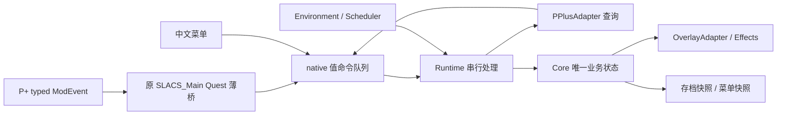

# SLACS2 NG 实现计划

更新：2026-11-05。本文确定后续实现顺序与模块分工，本轮只修改规划文档。

## 1. 要做成什么

把 `E:/source/repos/SLACS2 p+ 0.7` 的业务迁到 C++ SKSE 插件，保留原有功能目的。层数、衰减、清洗、效果、菜单和存档由 DLL 管理；Papyrus 只接收 P+ 事件并转交参数。

已确定的范围：

- 只支持 Skyrim SE **1.6.1170**，使用当前项目的 CommonLibSSE-NG。
- 面向新档，重新组织状态和存档格式。
- 直接调用 RaceMenu C++ API；SlaveTatsNG 只作参考和共存测试对象。
- 菜单使用 `E:/source/repos/SKSE-Menu-Framework-3-master`，界面全部中文，移除 MCM。
- 用 C++ 容器、调度、引擎查询和 SKSE 序列化替代 StorageUtil、JContainers、DbFormTimer、PO3。
- 自然衰减补算睡眠、等待和快速旅行经过的游戏时间；雨水只累计已经观测到的室外降雨时段。
- P+ 的 `tid` 就是当前动画过程 ID；唯一自动加层入口是 `SexlabOrgasmSeparate`。
- 复用原 ESP、Main Quest 和挂载脚本的名字。

## 2. 保留哪些名字，怎样接事件

| 项目 | 固定身份与处理方式 |
| --- | --- |
| ESP | `SLACS_2_Plus_SCO.esp` |
| Main Quest | `SLACS_Main_Q`，保留原记录身份 |
| Quest 查找 | 原文件记录 `04000D62` 的 local ID 为 `0x000D62`；按 local ID + ESP 文件名查找，加载序号由游戏解析 |
| VMAD 脚本类 | `SLACS_Main`，继续 `extends Quest` |
| 脚本产物 | 改写原 `SLACS_Main.psc`，编译为同名 `SLACS_Main.pex` |
| native 声明 | 放在同一个 `SLACS_Main.psc` 中，C++ 注册类名也为 `SLACS_Main` |

桥脚本保留 `RegisterEvents()`、`UnregisterEvents()`，订阅关系固定如下：

| P+ 通知 | Quest Event | 调用的 Global Native |
| --- | --- | --- |
| `SexlabOrgasmSeparate(Form sourceActor, int tid)` | `OnPPlusOrgasm(Form sourceActor, int tid)` | `NotifyOrgasm(Form sourceActor, int tid)` |
| `HookAnimationStart(int tid, bool hasPlayer)` | `OnPPlusStart(int tid, bool hasPlayer)` | `NotifySceneStart(int tid, bool hasPlayer)` |
| `HookAnimationEnd(int tid, bool hasPlayer)` | `OnPPlusEnd(int tid, bool hasPlayer)` | `NotifySceneEnd(int tid, bool hasPlayer)` |

三个 native 的 Papyrus 声明均为 `Function … Global Native`。Event 只转发参数，成员与交互查询由 C++ 完成；`hasPlayer` 不在脚本中用来排除随从场景。开始和结束通知只维护过程上下文。

复用名字时同步清理 ESP：保留 Main Quest，移除其旧 SexLab/MCM/SpellHandler/FormList 等业务属性；移除旧 MCM、SpellHandler Quest 及其 alias/VMAD 绑定；删除 33 个挂旧业务脚本的 SexLab MGEF 覆盖。仍需的自有 Spell/MGEF/EFSH 与 Mega 种族 FormList 保留，由 C++ 按记录查找。脚本文件、VMAD 和属性一起更新，防止留下失效挂载。

DLL 在 Papyrus 注册阶段绑定 native；新游戏和成功读档后，等待原 Quest 的 VM 对象就绪，再调用 `RegisterEvents()`。它只管理本 Quest 的三项订阅，未就绪时按共享调度器有界重试。

## 3. 接口现在定下，实现按顺序接上

[接口契约](INTERFACES.zh-CN.md) 固定命名空间、文件位置、DTO 字段、函数签名、单位和完成结果。主计划安排实现顺序，接口文档规定模块怎样协作，研究文档保留来源证据。

| 模块 | 固定职责 |
| --- | --- |
| `Runtime`、`Ingress`、`ActorRegistry` | 生命周期、值命令队列、串行处理入口、会话内 actor 身份与引擎 handle 映射 |
| `Papyrus`、`PPlusAdapter` | 原脚本 native 绑定、P+ 异步查询、把通知整理成目标 actor 的加层操作 |
| `Core` | 七区域状态、加层/清除/时间结算和修订号；只依赖值类型 |
| `Scheduler`、`Environment` | 共享期限、取消和重试；在游戏执行阶段采样环境与时间 |
| `OverlayAdapter`、`Effects` | 将逻辑状态投影成自有覆盖层和自有效果 |
| `Settings`、`Menu` | 全局设置、中文菜单、状态快照和维护命令 |
| `Serialization` | 版本化 co-save，保存完整提交的业务快照，读入 staging 后恢复 |

共用约定：

- `slacs` 命名空间、C++23；纯业务层使用 `ActorId`，引擎 handle 留在运行时模块。
- native 入口复制有效 Form 参数的 FormID、tid 和本次序号后入队；Runtime 在游戏执行阶段解析 actor。
- VM 回调投递拥有自身数据的结果，Runtime 收到后调用 Core。
- Core 返回变更结果，Runtime 更新调度、外观、效果与快照。适配器只保留请求和表现缓存。
- 每个请求都有完成、失败、超时或取消结果；旧会话的完成结果被丢弃。

每一步都同时修改模块实现和 Runtime 调用方。当前步骤完成后，这条链就能运行；后续步骤扩充能力，沿用已经接好的入口。

## 4. 按这九步实现

### S1：建立能加载的运行时和共用类型

实现基础类型、命令队列、ActorRegistry、Runtime 生命周期和默认设置。配置路径固定为 `Data/SKSE/Plugins/SLACS2NG.json`。在插件入口接入 SKSE 消息、Papyrus 注册与序列化回调的归属，业务模块在各自步骤启用。

同时锁定 1170 实际使用的 SKSE、RaceMenu、Menu Framework DLL/头文件组合，记录版本与文件校验值。CommonLib 子模块固定为 `15ad90b31b2ca09cf477c7e1a43ff5ff05af120f`；本地 SKSE 源码基线为 2.2.6/1170。当前 RaceMenu 源码声明的是 1.7.99/GOG 1179，先取得匹配 1170 的版本。

确定串行游戏处理入口，核对任务、VM、UI 和生命周期回调的执行阶段与重入情况。比较已有更新入口和单个等待线程唤醒 SKSE task 两种来源；选择只影响 Scheduler 内部，业务接口不变。

**完成标志：**1170 正常加载；错误运行时在访问重定位前被拒绝；测试命令能入队并被消费；加载/退出时会话正确切换。目录与 API 从这一步按接口文档建立。

### S2：复用原 Quest，打通 P+ 通知

实现同名 `SLACS_Main` 薄桥、三个 native 入口和重订阅。同步编辑原 ESP 的 Quest/VMAD/属性及废弃记录，构建流程编译并打包 `SLACS_Main.pex`。原生入口把参数转成 S1 的值命令，Runtime 接收并记录。

**完成标志：**新游戏、读档后均能订阅；orgasm/start/end 参数和次数正确；同一 actor 在同一 tid 中的连续合法 orgasm 全部到达；没有 missing script/property 挂载日志。安装包只需这一份桥 PEX。

### S3：把一次 P+ 通知变成明确的加层请求

实现 `PPlusAdapter`，由 Runtime 调用。查询现有 P+ 的参与者、source 分类与 source→target 有向交互，按成年女性 NPC 和原有男性受方规则生成目标区域与数量；不要求玩家或随从在场，不查询随从身份。

同一次通知的异步查询归入一个请求，完成后投递一个结果；Runtime 按已经采集的同 tid 请求顺序交付，S4 从这个固定入口接 Core。请求失败、过程结束和读档取消均有终结结果。保留成功 orgasm 的语义与同一过程中的多次合法通知。

**完成标志：**单来源、多目标、多人、仅随从过程得到可核对的目标区域；连续通知分别完成；结束、tid 复用、查询失败和读档后没有旧请求误提交。记录桥/查询延迟，确认阶段变化下结果可用。

### S4：先让一个区域真正显示出来

实现 Core 的状态与加层/清除接口，把 S3 完成结果接入 Core。先完成 `BodyVaginal` 普通资源 profile 和 `OverlayAdapter` 的接口握手、自有槽位分配、差量提交、清除及 3D 重建恢复。Core 的七区域数据结构一次建立，其余资源映射在 S7 补齐。

**完成标志：**真实 P+ 通知改变逻辑层并显示覆盖；维护命令能清除和刷新；只提交所需差量；重建 3D 后能恢复；其他模组覆盖层正常。normal/specular 通道按实际 NIF/DDS 验证。

### S5：完成保存、读档与会话切换

实现 `Serialization`，将 Core 完整提交后的快照接入保存回调；读取回调同步验证数据并完成 FormID 重映射，交给 Runtime 恢复。加载时关入口、取消请求和期限、清缓存；成功后恢复状态、重订阅 Quest，再按 actor/3D 就绪情况重建表现。

**完成标志：**S4 的覆盖可保存、读档恢复；连续换档、失败读档、丢失引用和加载时请求完成均按约定处理；保存不等待 VM、任务或材质更新。存档中没有运行时 handle、节点、接口指针和任务对象。

### S6：接上衰减、雨水和游泳清洗

实现 `Scheduler`、`Environment` 和 Core 时间结算接口。Runtime 在同一次处理里先结算经过时间，再增加新层或应用新配置；期限归入共享调度器。等待、睡眠、快速旅行完成后唤醒结算。

自然衰减使用游戏小时；雨水只结算连续有效采样区间；游泳首版沿用立即全清。120 秒整体清除以活动游戏秒计时，可关闭，成功加层时重置该 actor 的期限。

**完成标志：**虚拟时间下改变调用频率得到相同衰减结果；长时间跳跃一次结算；暂停不消耗活动游戏秒；空部位不为未来新层积攒衰减；未知旅行雨量不被补算。期限集中到期时 pump 有界，退出能停止唤醒源。

### S7：补齐所有区域、纹理和附加效果

把 S4 路径扩展到七组外观：Body 的 Vaginal、Anal、Breast、legs，以及 Face、Hands、Feet。资源清单描述普通/Mega 贴图、可用通道和变体；缺少的自有材质键主动清除。未随包提供的 UBE profile 保持不可用。

实现 `Effects`，由 Core 状态派生 Oral/Vaginal/Anal 强度组合，对应自有 26 组效果；关闭效果时立即撤销。法术与槽位都是 Core 状态的投影。

**完成标志：**七区域加层、显示、清除、衰减、读档复用同一条链；资源通道正确；效果随逻辑状态改变；槽位不足只影响显示并产生诊断，不扣减逻辑层。

### S8：接入全中文菜单与配置保存

实现 Menu Framework 单一入口“体液覆盖/设置”，覆盖层、衰减清洗及角色管理在同页分组展开。菜单读不可变快照，修改与维护操作发送接口文档中的命令。配置统一验证后应用，保存结果与业务结果分别回到菜单。

提供“应用并保存”“还原未应用修改”“清除覆盖”“刷新显示”和折叠的测试加层。目标 actor 由游戏阶段写进快照；UI 操作经命令执行。交付中文宿主文本、汉字字体与字形配置。

**完成标志：**同页分组中文无缺字；配置重启后有效，读档不覆盖全局设置；失效目标有中文结果；菜单开关、暂停/恢复与字体重建正常。

### S9：逐项验收并打包

核对 DLL、原名 ESP、同名 `SLACS_Main.pex`、资源和中文菜单依赖。验证 RaceMenu/SlaveTatsNG 共存、多人场景、NPC 卸载、first/third person 切换、长时间运行与连续读档。BiS/DnB 找到可用外部信号后才接入已有清除命令。

记录活跃 actor 数、环境采样与材质提交次数、pump 耗时、队列深度和请求延迟，按代表性场景调整预算。发布说明列出实际验证过的 1170 依赖组合。

**完成标志：**功能逐项通过，包内 VMAD/PEX/资源匹配，没有旧脚本工具调用和重复自动加层入口。

## 5. 第一版的玩法和时间规则

以下是实现基线，保留旧玩法方向。FIFO、连续游泳清洗和新渐变曲线留待效果比较后调整。

| 项目 | 实现基线 |
| --- | --- |
| 逻辑容量 | 每区域最多 5 层；到上限忽略新增层 |
| 来源与受方 | 沿用来源分类；允许女性体液默认开启；成年女性 NPC 不受玩家/随从身份限制；男性受方保留原有性别规则 |
| 外观与效果 | 不透明度默认 100%，全体 Mega 默认关闭，原 Mega 种族名单继续生效；附加效果默认开启，一级/二级阈值为 1/3 层 |
| 层移除顺序 | LIFO，先移除最后加入的层 |
| 自然衰减 | 默认每 1 游戏小时移除一层，支持关闭；补算跳过的游戏时间 |
| 雨水 | 已观测室外降雨区间增加等量衰减预算；雪不额外清洗 |
| 游泳 | 采样确认 `IsSwimming()` 时全清；涉水不视作游泳 |
| 整体限时清除 | 默认开启 120 活动游戏秒；成功加层重置 actor 的期限，可关闭 |
| 视觉渐变 | 第一版随层/透明度目标更新，连续淡出留待后续比较 |
| 可见容量 | 读取 RaceMenu 实际加载的 Normal 槽位容量，Body 四区域共享身体池；每区最多投影五层，优先显示较新的层，仅用空槽与自有槽 |

“120 活动游戏秒、加层重置”是新实现对限时规则的明确约定，暂停时停止；它不同于直接照搬旧 ActiveMagicEffect 的整套生命周期。槽位数是资源与配置上限，实际可用量由当前占用决定。

逐层衰减一次计算：`k = min(层数, floor((余量 + 已过游戏小时 + 有效雨水小时) / 每层间隔))`。雨水小时只在雨中加速开启时加入；关闭自然衰减同时停止这两项预算，整体限时清除独立控制。移除 k 层后保留不足一层的余量，区域清空即清零。新增层前先结算原有状态。配置变更先按旧参数结算至当前时间，再用新参数安排期限。

游戏日历小时用于自然衰减和已观测雨水；活动游戏秒用于限时清除及后续视觉过渡；`steady_clock` 用于唤醒、请求超时和执行预算。加载、暂停和未知环境区间会断开雨水采样连续性，下一次有效采样重新起算。

## 6. 实现时共同遵守的边界

Core 由 Runtime 的游戏处理入口串行修改；加载切换与引擎访问也在这个入口协调。native、VM、引擎和 RaceMenu 回调只复制约定数据并入队。队列锁释放后再调用外部接口。

延迟任务携带 actor 身份、会话 epoch 和所需修订号；执行时重新解析 handle 与当前 3D。epoch 淘汰已采集旧任务，handle 管理对象身份。VM 中尚未到 native 的旧通知无法单靠本插件 epoch 追溯，S2/S3 的加载用例覆盖这个边界。

集中期限队列和显式请求状态机作为首版结构。每次 pump 有预算，只有一个待处理唤醒；未完成工作留到下一次独立节拍，避免 SKSE task 自递归入队。协程以后若用于多阶段流程，沿用相同接口与取消规则，由执行器持有、恢复和销毁 frame。

RaceMenu 模块借用外部接口，只清理自有槽与键。`AddOverlays` 的公开 bool 名与本地实现语义相反，包装层使用核实后的显式值；`SetNodeProperties(..., false)` 仍可能同步写 3D，全部访问放在已验证的游戏执行阶段。安装回调只标脏。

保存回调同步写最近完整快照；读取回调同步读到 staging。线程、锁、handle、接口指针和协程 frame 不进存档。异步回调拥有自己的值数据，避免跨延迟引用栈变量或借用节点。

## 7. 需要时查这些研究记录

| 文档 | 查什么 |
| --- | --- |
| [旧版行为](research/legacy-behavior.md) | 七区域、资源、效果、ESP 挂载与旧逻辑问题 |
| [P+ 接收契约](research/pplus-native-events.md) | typed 参数、原 Quest 薄桥、native 边界、查询时序 |
| [Devious Curses 参考](research/devious-curses-events.md) | Papyrus Event → native 的源码证据 |
| [RaceMenu 接口](research/overlay-api.md) | ABI、材质槽、回调、所有权与共存 |
| [运行时调度](research/runtime-scheduling.md) | 天气、水中状态、时钟、任务和加载 |
| [协程](research/coroutines.md) | 调度比较、frame 所有权、恢复与取消 |
| [中文菜单](research/menu-framework.md) | consumer API、字体、宿主文本、UI 执行阶段 |

后续从 S1 开始，按 S1→S9 完成。接口见配套文档，每一步完成后推进下一步。

